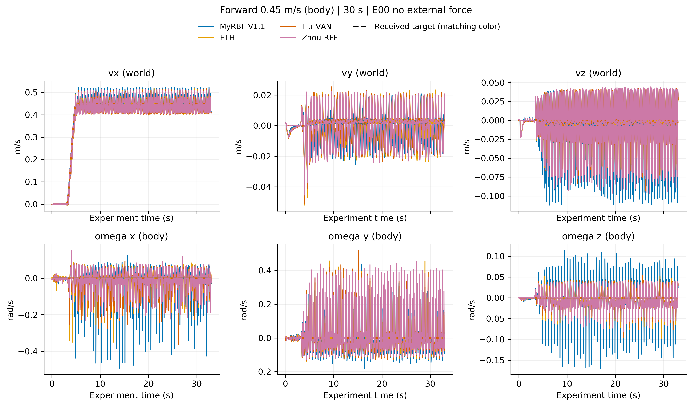
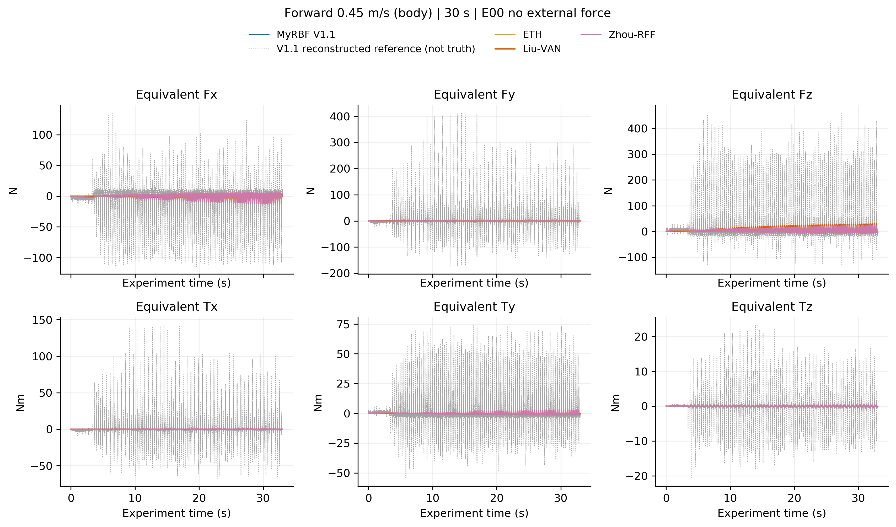
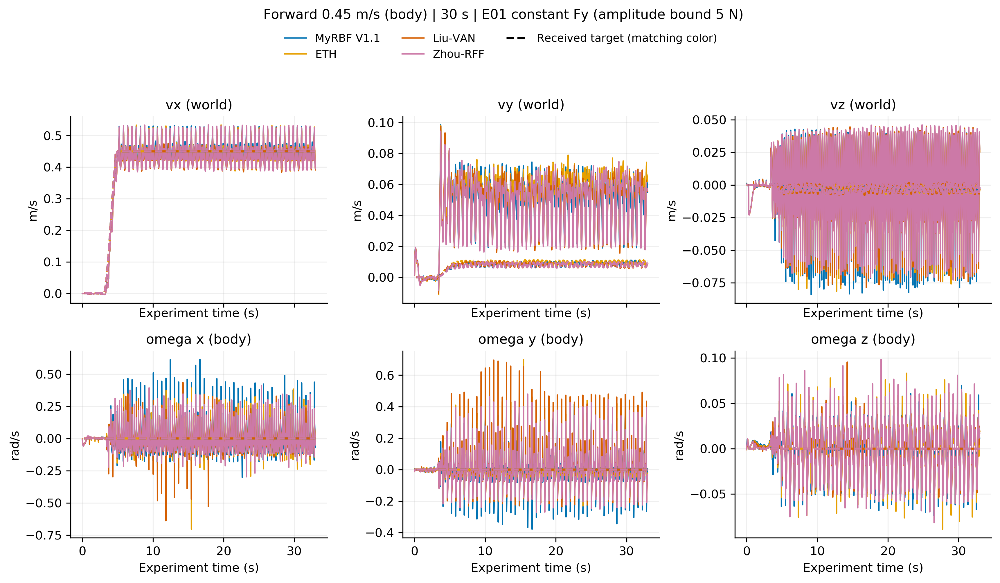
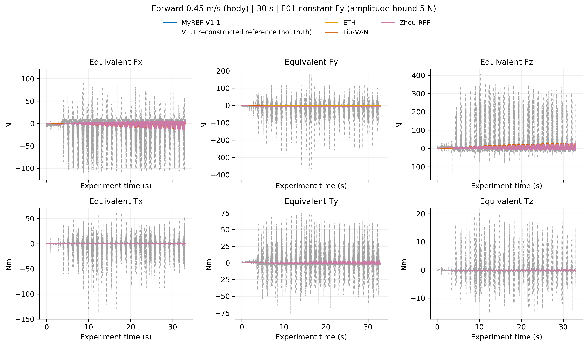
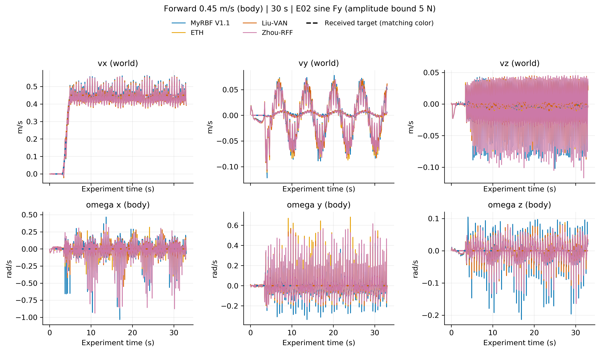
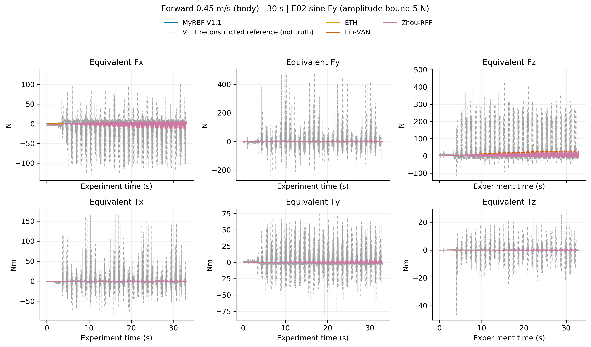
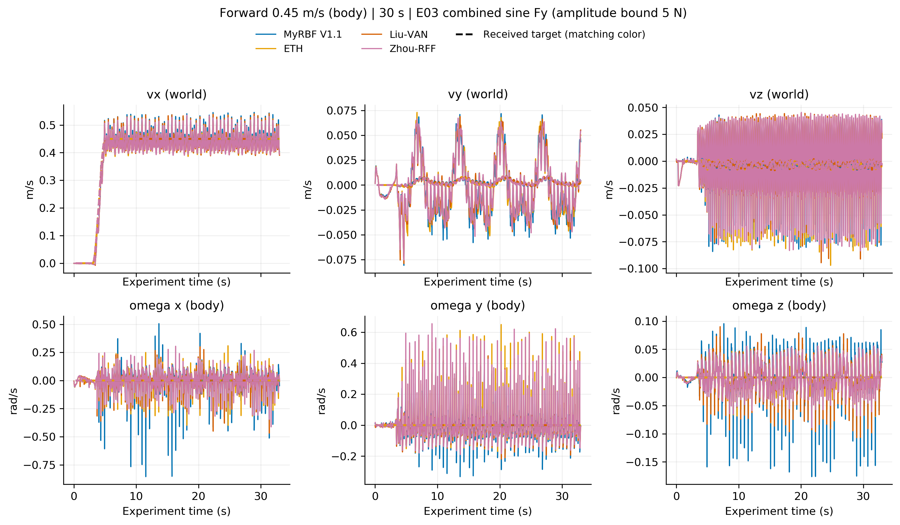
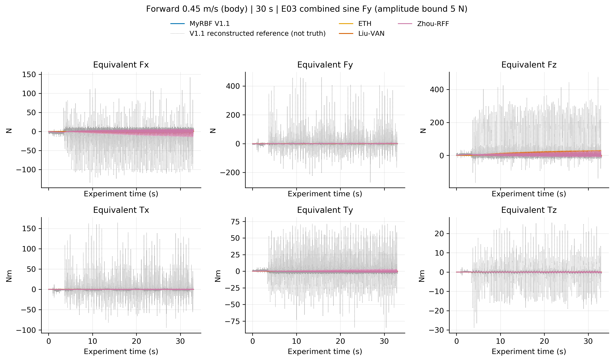

# V1.1 恒速前进：本轮完整结果入口

## 条件与来源

四种方法：MyRBF V1.1、ETH、Liu-VAN、Zhou-RFF。四个条件：无人工外力、恒定 Fy、正弦 Fy、双正弦 Fy。各条件只选取一份有效记录，共 16 份。

平地；总记录 33 s；2.4 s 发送 trot，3–5 s 平滑加速至机身前向 0.45 m/s，然后保持至记录结束。没有指定路径或终点。外力在正式记录全程存在：恒力 5 N；正弦 5 N / 0.15 Hz；叠加正弦 3 N / 0.15 Hz + 2 N / 0.30 Hz，两项相位均为 90°。详细定义见[运行说明](../../../run.md)。

原整轮 `20260930T144035.376750Z_2180a5f3` 有 13 项有效、3 项启动失败。人工排障补录共 5 次尝试，补齐 3 份有效记录；其中两次补录仍在准备阶段失败，随后修正首帧关节速度初值才补齐。失败尝试的来源摘要保存在交接包 handoff/cleanup_provenance.json；其原始大文件在 2026-10-03 清理，不纳入有效曲线，不冒称原整轮一次性全部成功。

补录来源：

- E02 Zhou：`20261001T030145.612466Z_bcc7525f`。
- E03 Liu：`20261001T025334.408185Z_6ecd26b5`。
- E00 V1.1：`20261001T030544.049194Z_fbbb931c`。

补录只增加启动异常记录、修正首次速度读数；方法的学习公式、外力、速度、时长和绘图定义未改。各份记录自己的源码和配置信息仍保留。这是同条件排障补齐集合，不是同一个未改变过的二进制冻结批次。路径见 [campaign_case_index.json](campaign_case_index.json)，检查结果见 [figures_final/validation.json](figures_final/validation.json)。

## 如何读图

每个条件两张图：六维速度跟踪、六维等效不确定力/力矩。实线为记录值，速度图同色虚线为该次实际收到的参考。保留原始波动，不平滑、不补零。速度图前三维为世界系质心线速度，后三维为机身角速度，不是位置或欧拉角导数。

等效不确定量图画的是学习得到的乘积，不是权值本身。灰色重建参考不是独立真值，也不是人工施加的外力；四方法原本学习目标并不完全相同。当前曲线不能据此宣称 V1.1 已准确估计全部扰动或优于对比方法。运行通过代表记录完整且未触发基本跌倒检查，不代表理论稳定性已经验证。

## E00 无人工外力

## E01 恒力

## E02 正弦

## E03 双正弦

