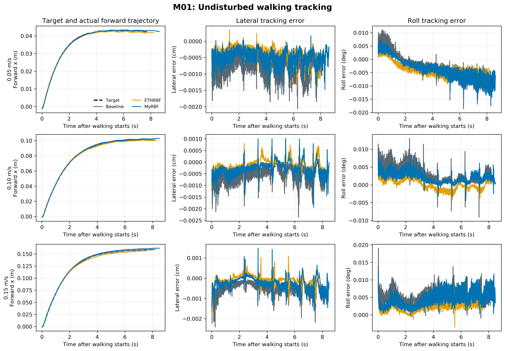
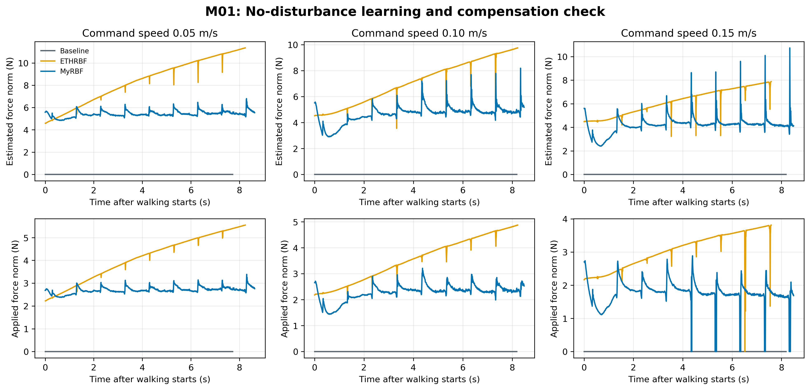
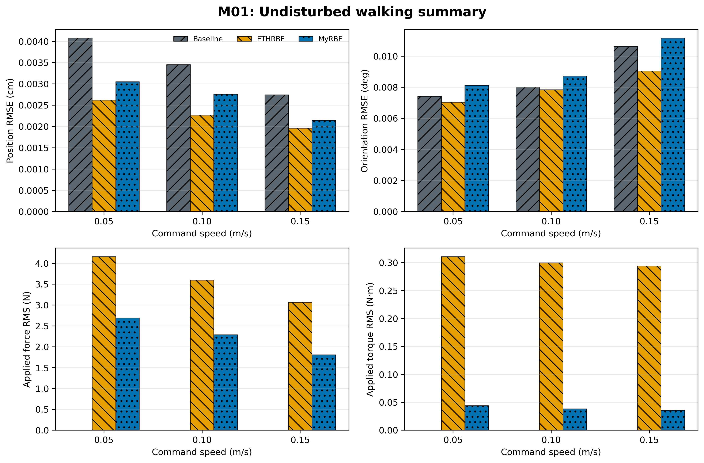

# M01 无扰动行走实验报告

## 实验设置

- Go2 Gazebo Classic，平整地面，`static_walk`；
- 速度为 0.05、0.10、0.15 m/s；
- 每次行走约 9 s，不施加外力和额外负重；
- 比较 Baseline、ETHRBF 和当前 MyRBF；
- 每个条件当前只运行 1 次；每场重新启动并清空学习历史。

## 结果

| 速度 | 方法 | 位置误差（cm）↓ | 姿态误差（deg）↓ | 侧移误差（cm）↓ | 侧倾误差（deg）↓ | 无扰动施力（N）↓ | 无扰动力矩（N·m）↓ | 前进距离（m） | 最低高度（m） | 结束状态 |
| ---: | --- | ---: | ---: | ---: | ---: | ---: | ---: | ---: | ---: | ---: |
| 0.05 | Baseline | 0.004 | 0.007 | 0.001 | 0.005 | 0.000 | 0.000 | 0.052 | 0.3319 | 15 |
| 0.05 | ETHRBF | 0.003 | 0.007 | 0.000 | 0.005 | 4.160 | 0.311 | 0.051 | 0.3324 | 15 |
| 0.05 | MyRBF | 0.003 | 0.008 | 0.001 | 0.005 | 2.695 | 0.044 | 0.052 | 0.3330 | 15 |
| 0.10 | Baseline | 0.003 | 0.008 | 0.001 | 0.004 | 0.000 | 0.000 | 0.113 | 0.3319 | 15 |
| 0.10 | ETHRBF | 0.002 | 0.008 | 0.000 | 0.002 | 3.600 | 0.300 | 0.113 | 0.3324 | 15 |
| 0.10 | MyRBF | 0.003 | 0.009 | 0.000 | 0.003 | 2.287 | 0.038 | 0.116 | 0.3330 | 15 |
| 0.15 | Baseline | 0.003 | 0.011 | 0.001 | 0.006 | 0.000 | 0.000 | 0.174 | 0.3319 | 15 |
| 0.15 | ETHRBF | 0.002 | 0.009 | 0.000 | 0.003 | 3.065 | 0.294 | 0.170 | 0.3325 | 15 |
| 0.15 | MyRBF | 0.002 | 0.011 | 0.000 | 0.005 | 1.809 | 0.035 | 0.176 | 0.3330 | 15 |

## 分析

- 0.05 m/s：MyRBF 的位置误差比 Baseline 低 25.1%；姿态误差相对高 9.5%，但绝对增加仅 0.0007°；施力和力矩分别比 ETHRBF 低 35.2% 和 85.8%。
- 0.10 m/s：MyRBF 的位置误差比 Baseline 低 20.2%；姿态误差相对高 8.9%，但绝对增加仅 0.0007°；施力和力矩分别比 ETHRBF 低 36.5% 和 87.3%。
- 0.15 m/s：MyRBF 的位置误差比 Baseline 低 21.9%；姿态误差相对高 5.1%，但绝对增加仅 0.0005°；施力和力矩分别比 ETHRBF 低 41.0% 和 88.0%。

三种速度下，目标前进轨迹和实际轨迹基本重合。MyRBF 的姿态误差相对 Baseline 略高，但绝对差值不足 0.001°；结合单次实验精度，不能解释为实际稳定性下降。ETHRBF 的无扰动估计随时间持续增大，而 MyRBF 保持在更低范围，因此当前更新方式更不容易在正常行走时积累不必要补偿。

## 自动检查

- 0.05 m/s：通过。
- 0.10 m/s：通过。
- 0.15 m/s：通过。

M01 总体判断：**通过**。

自动检查要求机器人安全结束，且 MyRBF 的位置和姿态误差不能相对 Baseline 明显恶化；无扰动时实际补偿也必须保持在预设安全范围内。这里的无扰动补偿可能同时包含模型误差补偿，不能全部理解为网络误判。

## 图

## 结论边界

本轮用于检查正常行走时的副作用，每个条件只有一次运行，不能替代最终重复统计，也不代表真机结果。
