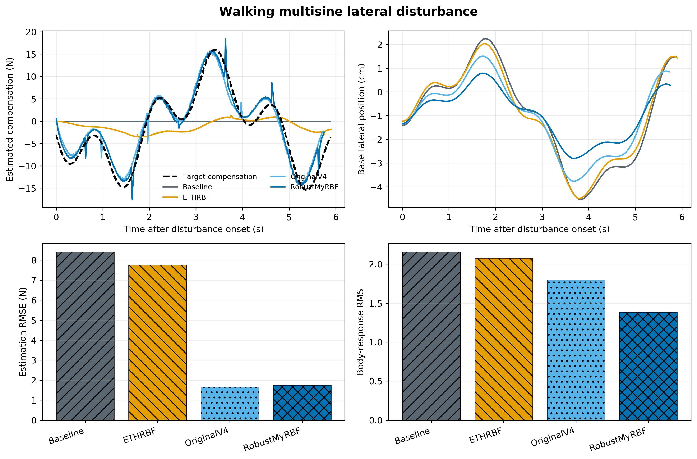
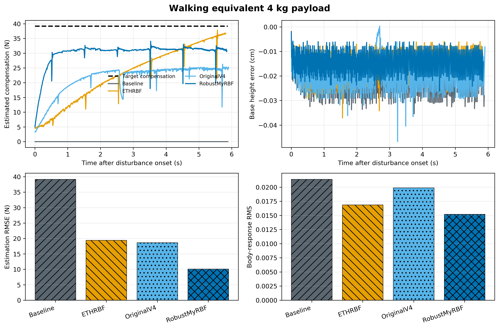
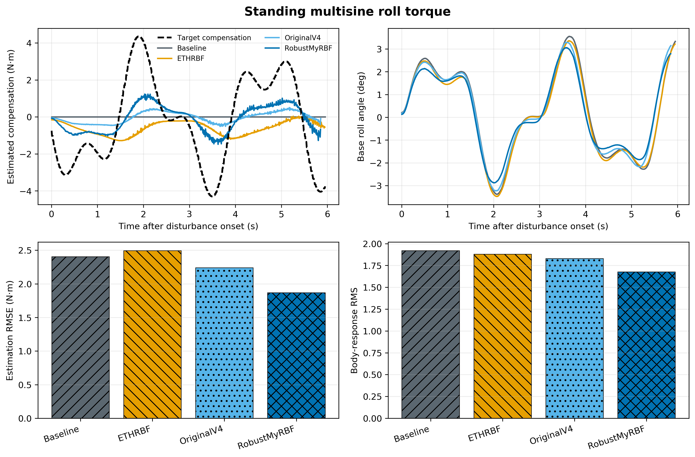

# Go2 MyRBF Gazebo 正式对比实验报告

日期：2026-08-30

## 1. 实验是否真实运行

本报告中的曲线和数字来自老师原 OCS2/ROS Noetic 环境中的 Go2 Gazebo 闭环仿真。每种方法都重新启动机器人、控制器、扰动程序和数据记录程序；图表由保存的 `state.csv`、`shadow.csv`、`wrench.csv` 和 `motion.csv` 自动生成，不是手工填写或离线构造的数据。

这些结果证明的是 Go2 Gazebo 中的迁移和闭环效果，不代表已经完成真实 Go2 实验。

## 2. 公共实验条件

| 项目 | 设置 |
| --- | --- |
| 机器人 | Unitree Go2 模型 |
| 仿真器 | Gazebo Classic，平整地面 |
| 控制框架 | 老师原有 OCS2 NMPC + 全身控制器 |
| 软件环境 | ROS Noetic Docker，工作区 `/tmp/myrbf_go2_catkin` |
| 行走步态 | `static_walk` |
| 行走命令 | 前向速度 0.08 m/s |
| 行走时段 | 扰动程序计时的第 4–13 s，共约 9 s |
| 扰动采样 | 50 Hz |
| 网络更新 | 100 Hz |
| 正式比较方法 | Baseline、ETHRBF、OriginalV4、RobustMyRBF |
| 重置方式 | 每场重新启动，网络权值和历史状态清零 |
| 重复次数 | 当前每个正式条件 1 次 |

四种方法使用相同机器人、地面、初始姿态、步态、运动命令和扰动时间表。正式结果只用于判断方法链路和主要效果，后续论文统计还需要多次重复。

## 3. 对比方法

| 图中名称 | 更新依据 | 是否参与控制 | 作用 |
| --- | --- | --- | --- |
| Baseline | 不更新 | 否 | 原 Go2 控制器基线 |
| ETHRBF | 机器人相对目标的跟踪误差 | 是 | 复现原 ETH 式更新 |
| OriginalV4 | 未被网络解释的预测残差 | 是，原保守作用比例 | 调参前方法 |
| RobustMyRBF | 未被网络解释的预测残差 | 是，本轮锁定作用比例 | 最终方法 |

图中的黑色虚线是抵消外界扰动所需的理想反向补偿。例如外界施加 `-39.2 N Fz` 时，理想补偿为 `+39.2 N Fz`。

## 4. 指标定义

所有指标只在扰动实际生效的时间段内计算。

| 指标 | 含义 | 趋势 |
| --- | --- | --- |
| 估计误差 | 网络估计补偿与理想反向补偿之间的均方根差 | 越小越好 |
| 波形相关性 | 估计曲线与理想补偿曲线的形状一致程度 | 越接近 1 越好 |
| 机身侧移 | Go2 机身横向位置的均方根或最大绝对值 | 越小越稳 |
| 高度误差 | 实际机身高度与控制器目标高度之间的差 | 越小越稳 |
| 机身侧倾 | Go2 机身横滚角的均方根或最大绝对值 | 越小越稳 |
| 最低高度 | 负重期间机身最低高度 | 越高表示下沉越少 |

恒定负重没有波形变化，因此相关性没有解释意义，V2 主要看估计误差、最低高度和姿态。

## 5. V1：行走时多频侧向扰动

### 5.1 实验条件

- Go2 在平地使用 `static_walk`，前向命令 0.08 m/s；
- 行走从第 4 s 开始，持续约 9 s；
- 侧向力从第 6 s 开始，持续约 6 s；
- 扰动由两个未参与最终调参的频率叠加：

```text
Fy(τ) = 10 sin(2π·0.22τ) + 6 sin(2π·0.77τ + π/6) N
0 ≤ τ < 6 s
```

- 实际记录范围约为 -15.97 N 至 +15.39 N；
- 四种方法分别独立运行一次。

### 5.2 实验曲线



左上图比较理想补偿和四种方法的估计；右上图比较机身侧移；左下图是估计误差；右下图是侧移均方根。

### 5.3 结果

| 方法 | 侧移均方根（cm）↓ | 最大侧移（cm）↓ | 侧倾均方根（deg）↓ | 最大侧倾（deg）↓ | 估计误差（N）↓ | 波形相关性↑ |
| --- | ---: | ---: | ---: | ---: | ---: | ---: |
| Baseline | 2.157 | 4.528 | 0.962 | 1.722 | 8.414 | 0.000 |
| ETHRBF | 2.075 | 4.496 | 0.953 | 1.645 | 7.756 | 0.392 |
| OriginalV4 | 1.801 | 3.764 | 0.864 | 1.516 | **1.665** | **0.989** |
| RobustMyRBF | **1.384** | **2.808** | **0.679** | **1.140** | 1.742 | 0.984 |

### 5.4 分析

RobustMyRBF 相对 Baseline 将机身侧移均方根降低 35.8%，侧倾均方根降低 29.5%；相对 OriginalV4 分别降低 23.1% 和 21.5%。

OriginalV4 的估计误差比 RobustMyRBF 小 0.077 N，但它实际用于稳定机器人的补偿较弱，因此机身运动更大。这说明本实验不是单纯追求“估计曲线最好看”，而是同时评价估计和闭环稳定性。

ETHRBF 只在机器人已经产生跟踪偏差后获得明显更新信号，因此对快速变化的复杂侧向力反应较慢。

## 6. V2：行走时等效 4 kg 负重

### 6.1 实验条件

- 行走条件与 V1 相同；
- 从第 6 s 开始向机身持续施加 `Fz = -39.2 N`，持续约 6 s；
- `39.2 N = 4 kg × 9.8 m/s²`，因此称为等效 4 kg 负重；
- 该场景只模拟额外重力，不包含真实重物带来的质量分布和转动惯量变化。

### 6.2 实验曲线



左上图比较理想向上补偿和各方法估计；右上图是机身高度误差；下方两图分别比较估计误差和高度误差。

### 6.3 结果

| 方法 | 最低高度（m）↑ | 高度误差均方根（cm）↓ | 最大高度误差（cm）↓ | 最大侧倾（deg）↓ | 估计误差（N）↓ | 平均实际补偿（N） |
| --- | ---: | ---: | ---: | ---: | ---: | ---: |
| Baseline | 0.3173 | 0.0214 | 0.0354 | 0.359 | 39.200 | 0.000 |
| ETHRBF | 0.3211 | 0.0169 | 0.0371 | 0.270 | 19.425 | 10.680 |
| OriginalV4 | 0.3185 | 0.0199 | 0.0467 | 0.263 | 18.631 | 3.190 |
| RobustMyRBF | **0.3252** | **0.0152** | **0.0261** | **0.178** | **10.101** | 14.461 |

### 6.4 分析

RobustMyRBF 相对 Baseline 将最低高度提高约 7.9 mm，高度误差均方根降低 29.0%，最大侧倾降低 50.5%。相对 OriginalV4，估计误差降低 45.8%，高度误差降低 23.7%。

曲线也表明 RobustMyRBF 没有完整估计到 39.2 N，更没有把全部 39.2 N 直接送入控制器。当前竖直实际补偿上限是 15 N，实验中最大补偿达到该上限。这个设计优先保证安全和稳定，当前结果能证明负重下机身更稳定，不能声称已经成为精确测力装置。

## 7. V3：站立时多频侧倾力矩

### 7.1 实验条件

- Go2 保持四脚站立，不发送行走命令；
- 侧倾力矩从第 4 s 开始，持续约 6 s；
- 力矩由两个新频率叠加：

```text
Tx(τ) = 3 sin(2π·0.37τ) + 1.5 sin(2π·0.89τ + π/6) N·m
0 ≤ τ < 6 s
```

- 实际记录范围约为 -4.36 N·m 至 +4.30 N·m。

### 7.2 实验曲线



左上图比较力矩补偿估计；右上图比较机身侧倾；下方两图分别是估计误差和侧倾均方根。

### 7.3 结果

| 方法 | 侧倾均方根（deg）↓ | 最大侧倾（deg）↓ | 估计误差（N·m）↓ | 波形相关性↑ | 平均实际补偿（N·m） |
| --- | ---: | ---: | ---: | ---: | ---: |
| Baseline | 1.921 | 3.556 | 2.405 | 0.000 | 0.000 |
| ETHRBF | 1.881 | 3.476 | 2.496 | -0.086 | 0.305 |
| OriginalV4 | 1.829 | 3.293 | 2.239 | 0.585 | 0.021 |
| RobustMyRBF | **1.676** | **3.056** | **1.867** | **0.804** | 0.323 |

### 7.4 分析

RobustMyRBF 相对 Baseline 将侧倾均方根降低 12.8%，最大侧倾降低 14.0%；相对 OriginalV4 分别降低 8.4% 和 7.2%，估计误差降低 16.6%。

这组结果证明力矩方向已经参与控制并产生稳定收益，但估计幅值仍明显小于理想补偿，改善程度也弱于侧向力和负重方向。后续应优先继续研究力矩方向，而不是只增加更多侧向力演示。

## 8. 运行安全检查

- 12 场正式运行均生成完整状态、网络和扰动记录；
- V1 和 V2 的四种方法都完成指定低速行走；
- V3 的四种方法都保持站立；
- 所有正式运行结束时接触模式均为 15，即四脚接触；
- 最低机身高度均高于 0.25 m 安全门槛；
- 日志中没有崩溃、非有限控制量或进程异常退出；
- RobustMyRBF 的支撑脚分配没有触发整体缩小。

## 9. 总体结论

现有结果可以证明：

1. MyRBF 已经接入 Go2 Gazebo 的真实闭环控制数据和接触力入口；
2. RobustMyRBF 在三种正式扰动中，机身稳定性都优于 Baseline、ETHRBF 和 OriginalV4；
3. 侧向复杂扰动和等效负重的改善最明显；
4. 侧倾力矩方向有效，但仍需要继续优化；
5. 当前方法更适合表述为“提高扰动下的运动稳定性”，不适合表述为“精确恢复全部真实外力”。

现有结果还不能证明：

- 真机上同样有效；
- 六个方向都已经完成同等级验证；
- 多地形下仍然有效；
- 结果具有统计显著性。

论文级下一步应固定当前参数，增加多次重复、多地形、真实质量与惯量变化，以及真机只观察和小比例闭环试验。

## 10. 结果文件

- 图、PDF、自动统计：[`analysis`](analysis)
- 完整调参说明：[`../../docs/MYRBF_GO2_TUNING_AND_COMPARISON_20260830.md`](../../docs/MYRBF_GO2_TUNING_AND_COMPARISON_20260830.md)
- 迁移和代码交付说明：[`../../docs/GO2_MYRBF_EXPERIMENT_AND_CODE_DELIVERY_20260830.md`](../../docs/GO2_MYRBF_EXPERIMENT_AND_CODE_DELIVERY_20260830.md)
- 原始数据：已从活动工作区清理，保存在 [`../../deliverables/go2_myrbf_go2_gazebo_delivery_20260830.zip`](../../deliverables/go2_myrbf_go2_gazebo_delivery_20260830.zip) 中
